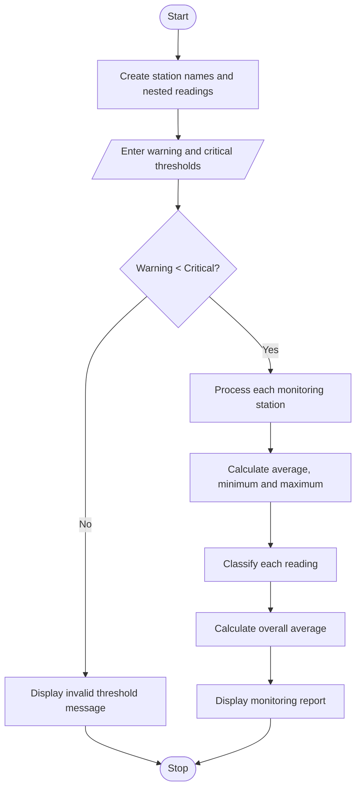

# Environment
# Environmental Monitoring Data Analyzer

## 1. Project Description

The Environmental Monitoring Data Analyzer is a Python-based application designed to analyze environmental readings such as air-quality or water-quality measurements.

The program uses nested lists to store environmental readings from multiple monitoring stations. It calculates the average, minimum, and maximum values and classifies each observation based on user-defined threshold values.

The system helps identify normal, warning, and critical environmental conditions.

## 2. Objectives

- To analyze environmental monitoring data using Python.
- To store readings using nested lists.
- To calculate average, minimum, and maximum readings.
- To classify observations using threshold values.
- To identify environmental conditions that require attention.
- To generate an overall monitoring summary.

## 3. Problem Statement

Environmental monitoring involves collecting readings from different locations. Analyzing these readings manually can be time-consuming.

Develop a Python program that analyzes nested lists of environmental readings, calculates averages and extreme values, and classifies observations into Normal, Warning, and Critical categories using supplied threshold values.

## 4. Assumptions

1. Environmental readings are stored in nested lists.
2. Each monitoring station contains at least one reading.
3. All readings are numeric values.
4. The warning threshold must be smaller than the critical threshold.
5. Readings less than or equal to the warning threshold are classified as Normal.
6. Readings above the warning threshold and less than or equal to the critical threshold are classified as Warning.
7. Readings above the critical threshold are classified as Critical.

## 5. Python Concepts Used

- Variables and data types
- Lists and nested lists
- For loops
- If-elif-else statements
- Functions
- User input
- Arithmetic operations
- Built-in functions: `sum()`, `min()`, `max()`, `len()`
- Basic output formatting

## 6. Algorithm

1. Start the program.
2. Create a list containing monitoring station names.
3. Create a nested list containing environmental readings.
4. Get warning and critical threshold values from the user.
5. Check whether the warning threshold is smaller than the critical threshold.
6. If the thresholds are invalid, display an error message.
7. Otherwise, process each monitoring station.
8. Calculate the average, minimum, and maximum readings.
9. Classify every reading using the threshold values.
10. Calculate the overall average of all readings.
11. Display the environmental monitoring report.
12. Stop the program.

## 7. Pseudocode

```text
START

Create station names
Create nested list of readings

INPUT warning_limit
INPUT critical_limit

IF warning_limit >= critical_limit
    DISPLAY invalid threshold message
ELSE
    SET total_sum = 0
    SET total_readings = 0

    FOR each monitoring station
        Calculate average
        Find maximum reading
        Find minimum reading

        FOR each reading
            IF reading <= warning_limit
                DISPLAY Normal
            ELSE IF reading <= critical_limit
                DISPLAY Warning
            ELSE
                DISPLAY Critical
            END IF
        END FOR

        Update total_sum
        Update total_readings
    END FOR

    Calculate overall average
    DISPLAY monitoring summary
END IF

STOP
```

## 8. Flowchart



## 9. Python Source Code

File name: `main.py`

The complete Python implementation is available in this repository.

## 10. Test Cases

| Test Case | Input | Expected Result |
|---|---|---|
| TC01 | Reading = 25, thresholds = 40, 65 | Normal |
| TC02 | Reading = 45, thresholds = 40, 65 | Warning |
| TC03 | Reading = 70, thresholds = 40, 65 | Critical |
| TC04 | Reading = 40, thresholds = 40, 65 | Normal |
| TC05 | Reading = 65, thresholds = 40, 65 | Warning |
| TC06 | Warning = 70, Critical = 50 | Invalid thresholds |

## 11. Output

The program displays:

- Monitoring station names.
- Environmental readings.
- Average readings for each station.
- Maximum and minimum readings.
- Classification of individual observations.
- Total number of monitoring stations.
- Total number of readings.
- Overall average reading.

## 12. Conclusion

The Environmental Monitoring Data Analyzer successfully analyzes environmental readings using Python. It uses nested lists, loops, conditional statements, and functions to calculate statistical values and classify environmental observations.

This project demonstrates how Python programming can be used to organize environmental data, identify unusual readings, and generate meaningful monitoring reports.
